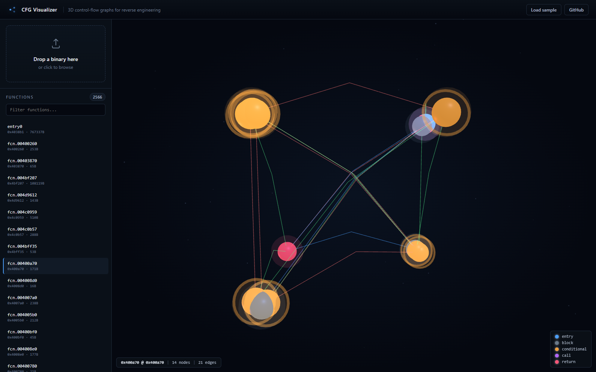

# CFG Visualizer

**A 3D control-flow graph explorer for reverse engineering.**

Drop in any ELF, PE, or Mach-O binary. CFG Visualizer disassembles it with
[radare2](https://github.com/radareorg/radare2), extracts the per-function
control-flow graph, and renders it as an explorable 3D scene you can fly
through. Click a node to read the disassembly, click again to dive deeper.

Built because staring at Ghidra's flat 2D graph view during a CTF at 2am is
the opposite of fun.

**Live:** [cfg-visualizer-eight.vercel.app](https://cfg-visualizer-eight.vercel.app)

The frontend is on Vercel, the radare2 backend is on Render. Both are
deployed, so you can drop a real binary in and get a real graph. No
**Load sample** fallback required.



That is a real busybox binary analysed by radare2: 2,566 functions listed, and
`fcn.00400a70` rendered as 14 basic blocks and 21 edges. Nodes are coloured by
kind, edges by flow type.

---

## Why this exists

When I'm solving a `picoCTF` reverse engineering challenge I usually have
two windows open: Ghidra for the CFG, and a terminal running `r2` for
searching strings. Both ship with a 2D graph view that gets cramped the
moment a function has more than 15 basic blocks. The interesting control
flow is right there in front of you — you just can't see it.

This project does one thing: it lifts the control-flow graph out of the
tool, makes it 3D, and lets you fly around it.

It's not a replacement for Ghidra. It's the view I want when I'm hunting
for the one branch that matters.

---

## Architecture

```
                         +----------------------+
   binary  (upload)  --> |  FastAPI  (Python)   |
                         |  r2pipe + radare2    |
                         +----------+-----------+
                                    |
                            JSON: { function,
                                    nodes, edges }
                                    |
                                    v
                         +----------+-----------+
                         |  Three.js  (browser) |
                         |  3D force layout      |
                         |  GSAP camera fly-to  |
                         +----------------------+
                                    |
                          click node -> disasm panel
```

### Data flow

1. Browser `POST`s the binary to `/upload`. Backend saves it to a temp
   directory, opens it with `r2pipe`, runs `aaa` (analyze all), returns
   `{ session_id, functions: [...] }`.
2. User picks a function. Browser `GET`s `/function/{addr}?session_id=...`.
   Backend runs `agj @ {addr}` (graph as JSON), transforms it into the
   canonical schema, returns it.
3. Frontend runs its own seeded 3D force layout to settle node positions,
   then hands those to Three.js meshes. No layout dependency, so nothing can
   break from a CDN. The seed is fixed, so the same binary always draws the
   same graph.
4. Click a node -> raycaster hit -> GSAP camera fly-to + side panel
   slides in with the disassembly.

### JSON schema (locked)

```jsonc
{
  "function": "check_password",
  "nodes": [
    { "id": "0x400526", "type": "entry",       "disasm": ["push rbp", "..."] },
    { "id": "0x400568", "type": "conditional", "disasm": ["cmp eax, 0x1337", "jne 0x400580"] },
    { "id": "0x400580", "type": "call",        "disasm": ["call puts@plt"] },
    { "id": "0x4005a8", "type": "return",      "disasm": ["ret"] }
  ],
  "edges": [
    { "from": "0x400526", "to": "0x400568", "type": "flow" },
    { "from": "0x400568", "to": "0x400580", "type": "jmp_false" }
  ]
}
```

Node `type`: `entry | normal | conditional | call | return`.
Edge `type`: `flow | jmp_true | jmp_false | call`.

---

## Quick start

### 0. Just look at it (no install)

Open the [live site](https://cfg-visualizer-eight.vercel.app) and drop a binary
in. If you have none handy, click **Load sample** in the top right to see the
3D view with a built-in CFG.

To deploy your own frontend (one CLI command, no local server):

```bash
cd ~/cfg-visualizer
npx vercel@latest --prod
```

That's it. Vercel will print a URL like `https://cfg-visualizer-<hash>.vercel.app`.

### 0b. Deploy the backend (optional, to run your own)

The frontend can talk to a backend you host yourself. To enable real binary
uploads from your Vercel URL, deploy the FastAPI backend somewhere that
supports Python + radare2 + long-running processes.

**Recommended: [Render.com](https://render.com) free tier** (web dashboard,
no CLI needed):

1. Sign up at [render.com](https://render.com) using **Continue with GitHub**
2. Click **New +** → **Web Service**
3. Select the **`zhameersheraz/cfg-visualizer`** repo (you may need to grant
   Render access to it under **Account Settings → GitHub**)
4. Render auto-detects the `Dockerfile` at the repo root. Confirm:
   - **Runtime**: Docker
   - **Region**: any near you
   - **Instance Type**: Free
5. Click **Advanced** and add these environment variables:
   - `CFG_CORS_ORIGINS` = `https://cfg-visualizer-eight.vercel.app`
     (your Vercel URL — must include the origin that's allowed to call the API)
   - Leave `PORT` blank — Render injects `10000` automatically
6. Click **Create Web Service**. First build takes 3-5 minutes.
7. When the deploy shows "Live", copy the URL — it looks like
   `https://cfg-visualizer-backend-xyz.onrender.com`
8. Open `frontend/js/api.js` and set the `BACKEND_URL` constant to that URL:
   ```js
   const BACKEND_URL = "https://cfg-visualizer-backend-xyz.onrender.com";
   ```
9. Commit and push. Vercel auto-redeploys the frontend with the new backend
   URL baked in.

**Check the deploy actually has radare2 in it.** A container missing `r2`
builds fine, serves `/healthz` fine, and then fails every single upload, so
check before you assume it works:

```bash
curl https://cfg-visualizer-backend-xyz.onrender.com/healthz
```

```json
{ "ok": true, "sessions": 0,
  "radare2": { "present": true, "path": "/usr/bin/r2", "version": "radare2 5.9.4 ..." } }
```

If `radare2.present` is `false`, the image is missing r2 and `/upload` will
answer `422 radare2 ... is not on PATH` for every file.

**Free-tier tradeoffs**: Render sleeps the service after 15 min of no
traffic, so the first request after a long pause takes 30-50s (cold start).
Subsequent requests are fast. For an always-on service, upgrade to the $7/mo
plan or use Fly.io / Railway.

**Security note**: the warning further down applies. You are running
`radare2` on a public server processing arbitrary uploads from the internet.
For a portfolio piece that is fine; for a real product, add authentication,
rate limiting, and a sandboxed subprocess runner.

### 1. Local development (full upload flow)

- Python 3.10+
- `radare2` on your `PATH` (this project shells out to it via `r2pipe`)

On Kali / Debian:

```bash
sudo apt update
sudo apt install -y radare2 python3-pip python3-venv
```

On macOS:

```bash
brew install radare2
```

Verify `r2` is available:

```bash
r2 -v
# radare2 5.x.x ...
```

### 2. Backend

```bash
cd backend
python3 -m venv .venv
source .venv/bin/activate
pip install -r requirements.txt
python main.py
# -> Uvicorn running on http://127.0.0.1:8000
```

You should see:

```
INFO:     Started server process [12345]
INFO:     Uvicorn running on http://127.0.0.1:8000
```

Smoke-test the endpoints (replace `samples/check` with any binary):

```bash
./test_api.sh /bin/ls 0x000000
```

The script will:
1. `GET /healthz`
2. `POST /upload` with your binary
3. `GET /function/{addr}` for one function
4. `GET /overview` (function-level graph)
5. `DELETE /session/{id}` to clean up

### 3. Frontend

The frontend is static — no build step.

```bash
cd frontend
python3 -m http.server 5500
# -> http://127.0.0.1:5500
```

Open `http://127.0.0.1:5500` in a browser. The dropzone accepts any binary;
the **Load sample** button shows a hand-built CFG without the backend so
you can see the visualizer working even when `r2` isn't installed.

If the frontend and backend are on different origins, set the API base
before `app.js` loads:

```html
<script>window.CFG_API_BASE = "http://10.0.0.5:8000";</script>
```

---

## Visual style

NOCTURNE — dark, high-contrast, subtle glow. Designed to read clearly in a
darkened CTF room, not to look like a screensaver.

- Background: `#050810` (deep ink, not pure black)
- Accent: `#4a9eff` (cool blue, used for `entry` nodes and `flow` edges)
- Conditional branches: amber (`#f0a040`) with a thin ring around the node
- `jmp_true` / `jmp_false` edges: green / red — they're the ones you hunt
  for
- Faint starfield behind the graph so empty space doesn't read as "broken"

---

## Repository layout

```
cfg-visualizer/
├── backend/
│   ├── main.py              # FastAPI app + session manager
│   ├── analyzer.py          # r2pipe wrapper + agj -> schema transform
│   ├── requirements.txt
│   └── test_api.sh          # curl-based smoke test
├── frontend/
│   ├── index.html
│   ├── css/style.css        # NOCTURNE theme
│   ├── js/
│   │   ├── app.js           # top-level controller
│   │   ├── graph3d.js       # Three.js renderer + 3D force layout
│   │   ├── api.js           # backend client
│   │   └── uploader.js      # drag-and-drop glue
│   └── samples/
│       └── sample_graph.json   # offline demo CFG
├── docs/
│   └── screenshot.png       # README screenshot
├── Dockerfile               # backend image, installs radare2 from its .deb
├── samples/
│   └── README.md            # where to put test binaries
├── README.md
├── .gitignore
└── LICENSE
```

---

## Known limitations (v0.1)

- **Security — the public upload endpoint is genuinely exposed.** The deployed
  backend runs `r2pipe` on a publicly reachable host, so anyone can upload
  arbitrary binaries and have `radare2` analyse them. It is fine for a
  portfolio piece and it is what the live demo runs on, but for anything real
  you want authentication, rate limiting, and a sandboxed subprocess runner.
  Sandboxing (namespaces, seccomp, `r2` plugins in a jail) is the v0.2 item.
- **Architecture coverage:** tested against x86-64 ELF and PE. ARM64/MIPS
  should work because `r2` handles them, but the node-classification
  heuristics in `analyzer.py:classify_block` are tuned for x86 op types.
- **Big binaries:** the in-memory session store holds the r2pipe handle
  for 30 minutes after the last request. A 200MB binary in `/tmp` for half
  an hour is fine; a 2GB one is not. v0.2 will stream and discard
  incrementally.
- **No live debugging.** v0.1 is static analysis only. The `/function`
  endpoint is read-only.
- **No persistence.** Closing the browser tab closes the session. That's
  intentional for v0.1 — there is no auth, no user, no DB.
- **Frontend is x86-64 first.** The node-type / edge-type vocabulary in
  the JSON schema is x86-flavored. ARM will need new edge types
  (`cbz`, `tbz`, `b.cond`).

---

## Roadmap

### v0.2 (next)
- [ ] Sandboxed `r2` execution (subprocess isolation)
- [ ] ARM64 / aarch64 node classification
- [ ] Search inside disassembly (`/` in the side panel)
- [ ] Export selected CFG as SVG / PNG

### v1.0
- [ ] Function-level binary diffing (drop in v1 and v2 of a binary, see
  which functions changed)
- [ ] Live debugger hook (gdb/r2 `ds`/`dcu` integration)
- [ ] Multi-user sessions with auth
- [ ] Persistent sessions (Postgres + S3)

### Beyond
- [ ] Taint-tracking overlay (highlight which nodes a string flows through)
- [ ] Path queries ("show me all paths from entry to function X")
- [ ] Plugin API for custom node renderers

---

## License

MIT — see [LICENSE](LICENSE).

Built by [zham](https://github.com/zhameersheraz). If you found this useful
during a CTF, let me know.
